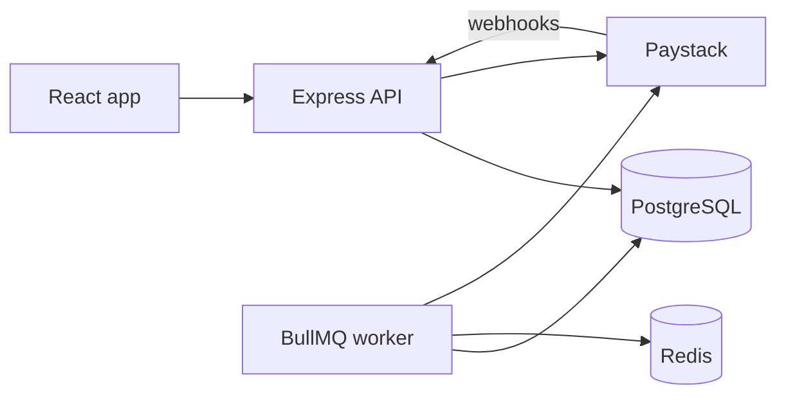
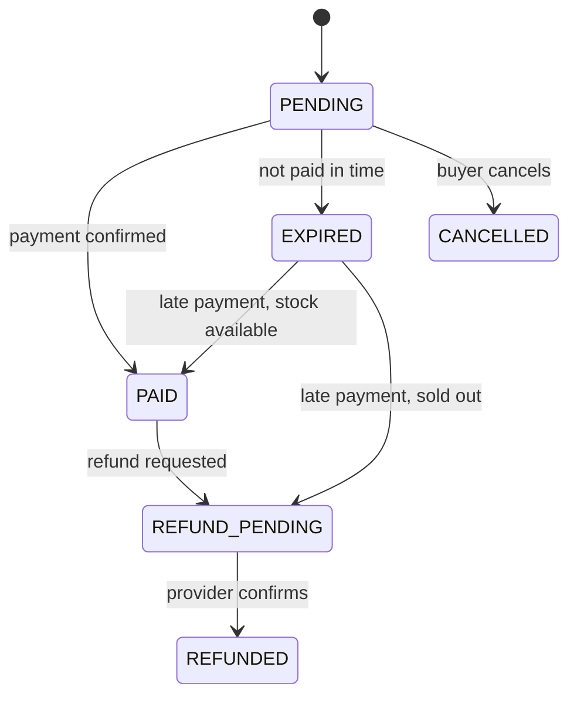

# Invite 

A ticket marketplace API for events in Nigeria: organizers publish events and sell
ticket categories, attendees buy with Paystack and receive QR tickets.
Built as a portfolio project, with the focus on correctness under load.

**Live demo:** [link] · **API docs:** [link] · 

[Screenshot or short screen recording]

## Features

- Organizer accounts, event and ticket-category management, sales summary, guest list
- Attendee accounts, orders, Paystack checkout, QR tickets
- Check-in scanning that can't admit the same ticket twice
- Refunds (customer, cancelled event, late payment) with provider retries
- Scheduled jobs: order expiry, payment reconciliation, refunds, reminders, cleanup

## Architecture



### Order lifecycle



## Design decisions

- **No overselling:** stock is a counter decremented with a single conditional
  `UPDATE ... WHERE available >= n`, plus a database CHECK constraint as a backstop.
- **Idempotent orders:** a client-supplied key makes retried requests return the same order.
- **Reservations expire:** unpaid orders hold stock for [10] minutes, then a cron job releases it.
- **Webhooks:** HMAC signature verified on the raw body, safe to deliver twice,
  and a reconciliation job catches missed deliveries.
- **Money:** integer kobo only, never floats.
- **Refunds:** recorded atomically first, sent to the provider by a retrying job (outbox pattern).
- **Check-in:** one conditional update, so two scanners can't both succeed.
- [Add anything else you're proud of]

## Tech stack

Node.js, TypeScript, Express 5, PostgreSQL, Prisma 6, Redis + BullMQ, Zod,
Vitest + Supertest, k6, React [+ Vite, TanStack Query].

## Project structure

```
apps/api         Express API, Prisma schema, jobs, tests
apps/web         React frontend
packages/shared  Zod schemas and types shared by both apps
load             k6 scripts, seed script, mock payment provider
```

## Getting started

Requirements: Node 18.18+ (22 recommended), PostgreSQL, Redis. Developed on WSL2 (Ubuntu).

```bash
git clone https://github.com/FinisherDev/invite.git && cd invite
npm install                          # run from the repo root
npm run build -w @invite/shared
createdb invite && createdb invite_test
cp apps/api/.env.example apps/api/.env   # then edit the secrets
cd apps/api && npx prisma migrate dev
npm run dev
```

### Environment variables

| Variable | Purpose |
|---|---|
| `DATABASE_URL` | Postgres connection string |
| `REDIS_URL` | Redis for the job queue |
| `JWT_SECRET` | 32+ characters |
| `PAYSTACK_SECRET_KEY` | Paystack test key |
| `ORDER_TTL_MINUTES` | How long unpaid orders hold stock |
| `RUN_JOBS_IN_API` | Run cron jobs inside the API process |

See `apps/api/.env.example` for the full list.

## Testing

```bash
npm test
```
Integration tests run against a real Postgres database (`invite_test`), not mocks.
They cover: 200 concurrent buyers for 50 tickets, idempotent retries, duplicate webhooks,
late payments, refund lifecycle, and simultaneous check-in scans.

## Load testing

k6 on-sale spike against [staging environment]:

| Metric | Result |
|---|---|
| Peak arrival rate | [ ] req/s |
| `POST /orders` p95 / p99 | [ ] ms / [ ] ms |
| Oversold tickets | 0 |

Scripts and instructions are in `/load`.

## API overview

| Area | Endpoints |
|---|---|
| Auth | `POST /auth/{attendees,organizers}/{register,login}`, `GET /auth/me` |
| Public | `GET /events`, `GET /events/:id` |
| Attendee | `POST /orders`, `GET /orders/:id`, `POST /orders/:id/{pay,cancel,refund}`, `GET /me/tickets` |
| Organizer | `/organizer/events` CRUD, `/publish`, `/cancel`, `/categories`, `/summary`, `/tickets`, `/check-in` |
| Webhooks | `POST /webhooks/paystack` |

## Known gaps

Free tickets, refresh tokens, password reset, and real email/SMS delivery are not built yet.

## Deployment

[Where it runs and how: fill in after deploying]

## License

MIT
